---
{
  "format": 1,
  "metadata": {
    "id": "archived-attributed-adjacency-graphs-aag-graph-based-cad-model-analysis-721b1f0a",
    "title": "Attributed Adjacency Graphs (AAG) & Graph-Based CAD Model Analysis",
    "question": "What findings, alternatives and limitations does the historical investigation document about Attributed Adjacency Graphs (AAG) & Graph-Based CAD Model Analysis?",
    "scope": "Historical OCP/CadQuery B-Rep recognition and reconstruction research: Attributed Adjacency Graphs (AAG) & Graph-Based CAD Model Analysis. Algorithm/software/license and experiment statements are report assertions, not newly reproduced results.",
    "summary": "Sourced CAD reverse-engineering study of Attributed Adjacency Graphs (AAG) & Graph-Based CAD Model Analysis; preserves proposed algorithms, comparisons, historical experimental results and stated validity/reconstruction limits.",
    "researched_at": "2026-08-06",
    "last_improved_at": null,
    "language": "en",
    "origin": {
      "kind": "imported",
      "platform": "unknown",
      "author": "unknown",
      "model": "unknown"
    },
    "related_reports": [],
    "warnings": [
      "Imported unchanged from an existing report. No fresh factual, technical, normative, legal or source-wide verification was performed for publication.",
      "Historical versions, author assertions and partial/draft/planning limitations remain in the body. Publication is not policy adoption, implementation, machinery approval or a safety certificate.",
      "Original citations and local/private dependencies are preserved; some links may be unavailable to readers. Third-party quotations and sources retain their own rights, not the report CC BY license."
    ],
    "superseded_by": null,
    "created_at": "2026-11-04T21:36:23.754Z",
    "updated_at": "2026-11-04T21:36:23.754Z",
    "imported_at": "2026-11-04T21:30:42.244Z"
  },
  "warnings": [
    {
      "code": "unknown_origin",
      "message": "Original platform or author unknown; review attribution."
    },
    {
      "code": "local_dependency",
      "message": "Local file reference may not be portable; review before publication."
    },
    {
      "code": "unresolved_citation",
      "message": "Unresolved or ambiguous imported reference or footnote; no target was invented."
    },
    {
      "code": "unverified_import",
      "message": "Imported claims and publication rights have not been checked."
    }
  ],
  "sourceDigest": "721b1f0a375c6e8393ee776dac2960f51795fb06c3eeba4f5c8780451f4a1a49",
  "proposalRevision": "3289e980e35cf08a1eea0195c1dec8f1bfca311a6adec4e44ff62d303f4bfd04"
}
---
# Attributed Adjacency Graphs (AAG) & Graph-Based CAD Model Analysis

**Reference compiled 2026-08-06** — deep research on the computer-science / graph-theory
side of B-Rep CAD analysis. Companion to the `cad_reverse` deterministic STEP→CadQuery
pipeline (which builds an AAG in `aag.py`).

> Scope: foundational AAG (Joshi & Chang), modern graph variants (EAAG, multi-level AAG,
> face-edge graphs), node/arc attribution schemes, blend detection chains, subgraph
> matching for feature templates, GNNs on CAD graphs, open-source AAG implementations,
> the convexity/concavity determinism problem, and seam-edge/singularity handling.

---

## 1. The Foundational AAG (Joshi & Chang, 1988)

**Paper:** S. Joshi, T.C. Chang, *"Graph-based heuristics for recognition of machined
features from a 3D solid model"*, Computer-Aided Design 20(2), 58–66, 1988.
DOI: `10.1016/0010-4485(88)90050-4`.

### 1.1 Formal definition

An AAG maps the **boundary representation (B-Rep)** of a solid into a graph

```
G = { N, C, A, T }
```

| Symbol | Meaning |
|--------|---------|
| `N` | set of **nodes** = faces of the solid |
| `C` | set of **connection arcs** = edges shared between two faces |
| `A` | connection attributes = edge type (convex / concave) |
| `T` | attribute value — **T=0 for concave edges, T=1 for convex edges** |

So the AAG is basically the **face-adjacency graph (FAG)** of Ansaldi et al. (1985) with a
binary convexity label on every arc.

### 1.2 Convexity / concavity from the dihedral angle

Edge convexity is determined by the **dihedral angle** between the two adjacent faces:

```
if  interior angle <= 180°  → edge is CONCAVE  (t = 0)
if  interior angle >  180°  → edge is CONVEX   (t = 1)
```

Equivalently, compute the angle between the outward face normals along the shared edge.
Concave edges bound **depressions** (pockets, slots, holes); convex edges bound
**protrusions** and the transition between a feature and the base/stock material.

### 1.3 The recognition algorithm

The AAG-based recognition runs in two stages:

1. **Graph decomposition.** Delete every node surrounded only by *convex* arcs. Rationale:
   *a convex edge does not contribute to a feature definition (Joshi & Chang 1988)* — convex
   edges mark the boundary between a feature and the stock. Removing these nodes splits the
   AAG into **disconnected sub-graphs**, each of which (ideally) corresponds to one feature.
2. **Feature identification.** Match each sub-graph against a **library of feature template
   graphs** (pockets, slots, steps, blind steps, blind slots, polyhedral holes).

**Pseudocode (original heuristic):**

```
function recognize(AAG):
    for each node n in AAG.nodes:
        if all incident arcs are CONVEX:      # n is part of the "base"
            mark n as deleted
    sub_graphs = connected_components(AAG - deleted_nodes)
    for each component C in sub_graphs:
        feature = match_template(C, FEATURE_LIBRARY)   # subgraph isomorphism
        if feature found: emit feature
        else: escalate / report UNMATCHED
```

### 1.4 Limitations (why the field moved on)

- **Polyhedral-only.** Original work handles only planar-faced (polyhedral) features
  (pockets, slots, steps, blind variants, polyhedral holes). Curved faces (cylinders, cones)
  were approximated by planar facets — losing accuracy.
- **Interacting/overlapping features.** Concave sub-graphs merge when features intersect,
  so the graph of an interacting feature set does not decompose cleanly. This is the
  classic "interacting features" problem (later attacked with hint-based + graph hybrid
  frameworks, e.g. Rahmani & Arezoo 2006).
- **Topological ambiguity.** Distinct features (a Slot vs a V-Slot) can share an identical
  AAG because the original AAG carries almost no geometric attribute on nodes.
- **Base-choice ambiguity.** Which faces are "stock" vs "feature" is not always determined
  by pure local convexity; requires global reasoning.

---

## 2. Modern Graph Variants

The evolution is summarized by a CAD Journal 2020 survey: researchers gained expressive
power either by **(1) enriching node/arc attributes** (adding geometric constraints) or
**(2) reinterpreting nodes/arcs** over richer entity sets (faces/edges → surfaces +
adjacency). This power comes at the cost of robustness and computational complexity.

### 2.1 Extended AAG (EAAG)

**Jhee & Kim (Kor. J. of ... 1996):** `EAAG = AAG + Σ F_i`, where `F_i` adds *face* attributes:

- face type (plane, cylinder, cone)
- whether the face is "machined"
- number of adjacent faces; number of adjacent concave / convex faces
- thread markings, **area**, face normal vector
- edge count, loop count
- and *edge* attributes (edge type — arc or line, loop type, arc angle, start/end
  coordinates, adjacent edge count)

A second EAAG formulation (survey ref [30]) adds five attributes per edge: **convexity,
existence, loop, geometry, blend type**.

### 2.2 Multi-level AAG (feature-relation graphs)

For interacting features, a two-tier hierarchy is common:

- **Low-level graph (Face Graph, FG):** like an AAG (faces as nodes) but node attributes
  carry plane-equation coefficients, or position+radius for spheres.
- **High-level graph (Feature Relation Graph, FRG):** nodes are the *primitive features*
  found by low-level recognition; arcs encode feature-**feature relationships** (intersect,
  parallel, stackable, mergeable), with attribute vectors of feature position/orientation/
  parameters.

### 2.3 Attributed *Face-Edge* graphs (nodes = faces+edges, or face-edge pairs)

These go beyond pure face-graphs to disambiguate topology:

- **EAFEG (Ye et al., CAD 2001):** each node = face with *face property* + *geometric type*
  (planar / quadric / free-form); each arc (face-pair) has five attributes: **edge
  convexity, parting-line info, loop type, vertex 1, vertex 2**. Explicit vertex attributes
  resolve the ambiguity caused by parallel arcs in standard AAGs. Geometric type explicitly
  supports free-form surfaces via an extended convexity criterion (Dong-derived).
- **EFAAG (Shao Jian et al., 2006/2010):** for moulded-part undercut recognition; adds
  attributes to both nodes and edges to define concave / convex / through-undercut features
  via subgraph matching.
- **HAAG (Holistic AAG):** adds **edge-node types** and quantitative attributes — face
  normals, face angles, edge lengths — for free-form surfaces.
- **GEAAG (Generalized EAAG):** *removes transitional (fillet/chamfer) faces* to simplify
  recognition.
- Other named relatives: **MAAG/MAAM** (multi-attributed adjacency graph/matrix),
  **RAAG** (reference-attributed AAG), **FES** (face-edge sequence) graph.

**Key structural idea:** adding face-edge/vertex attrs changes the matching from graph
isomorphism on a face graph to a richer partial-order/subgraph problem, at the cost of a
larger, sparser matching space.

---

## 3. Node Attribution

A "good" AAG node must distinguish geometrically identical faces across features. Node
attributes commonly stored (compiled from EAAG/EAFEG/AAGATNet/UV-Net-survey sources):

| Attribute | Type / values | Notes |
|-----------|---------------|-------|
| **Surface type** | plane, cylinder, cone, sphere, torus, NURBS / free-form, B-spline | from the surface geometry class |
| **Surface parameters** | position, axis, radius (cyl/cone), semi-axes (ellipse), apex angle | disambiguate size |
| **Area** | float (mm²) | scale-aware |
| **Perimeter** | float | robust to sampling |
| **Bounding box** | 6 floats (min/max x,y,z) | coarse geometric extent |
| **Face normal** | 3-vector (outward orientation) | crucial for convexity |
| **Centroid** | 3-vector | localization |
| **Loop / edge counts** | int | topology richness |
| **Curvature** | principal curvatures (k1,k2), mean H, Gaussian K | classifies surface type intrinsically |
| **Machined/undercut flag** | bool | manufacturability hint |
| **Blend flag / type** | bool + fillet/chamfer | transitional-face marking |

**Concrete scheme — gAAG node attrs (AAGATNet):** 13 node attributes that extend the
topology (UV-grid geometry) with extended face attributes, enabling free-form surface
recognition.

---

## 4. Arc Attribution

An AAG arc (face-pair) is the discriminating element. Attributes compiled:

| Attribute | Type / values | Notes |
|-----------|---------------|-------|
| **Edge convexity** | convex / concave / smooth | the core Joshi–Chang label |
| **Dihedral angle** | float (deg or rad) | continuous value; convexity is its discretization |
| **Edge type** | line / circle / ellipse / (NURBS) curve | intrinsic geometry of the shared curve |
| **Edge length** | float | via `BRepGProp` / curve length |
| **Loop type** | outer / inner | tells whether the edge sits on an inner profile |
| **Tangent (G1) continuity** | smooth vs sharp | drives `allowSmooth` detection |
| **Blend type** | none / fillet / chamfer / variable radius | transitional labelling |
| **Edge geometry / tangents** | sampled 1-D UV grid | ML representation (UV-Net) |
| **Vertex endpoints** | 2 vertices | EAFEG; resolves parallel-arc ambiguity |

**Concrete scheme (AAGATNet / gAAG):** 18 edge attributes including **Topological
Orientation** and **Dihedral Angles**.

---

## 5. Blend (Fillet / Chamfer) Detection on AAGs

Blends are *transitional faces* (cylindrical fillets, conical chamfers) whose recognition
is a prerequisite to recognizing the features they smooth.

### 5.1 Recognition signals

A blend face is recognized on the AAG by a combination of:

- **Surface type.** A constant-radius *fillet* is usually a small **cylindrical surface**
  sharing smooth edges with its two flanking faces. A *chamfer* is usually a **planar**
  (or conical) face at 45°. (For free-form B-spline blends, classify by curvature bands.)
- **Adjacency pattern.** A true fillet cylinder has exactly **two smooth (G1) arcs** to two
  parallel flanking walls, and maps to a *small parallel far-cap*. This forms a distinct
  sub-structure (an **s-cycle** / smooth-edge chain).
- **Edge vexity of incident arcs.** Flanks are smooth; the far edges may be concave or
  convex.

### 5.2 Chain finding & suppression (Slyadnev & Turlapov, 2020)

`Simplification of CAD Models by Automatic Recognition and Suppression of Blend Chains`
(Programming & Computer Software) implemented on OpenCASCADE / Analysis Situs:

1. Build the AAG over the body.
2. Identify **chains**: maximal connected runs of blend faces connected by smooth (G1)
   arcs. Consecutive fillets/chamfers of differing radius along a path form a *chain*.
3. Recognition produces a graph `G*` isomorphic to the AAG `G` but with extra blend
   attributes; the chain is a connected sub-structure of blend-marked nodes.
4. **Incremental suppression** via Euler-like operators (`KEV`, `KEF`, `KFMV` are the
   Euler operators implemented on OCC): contract/delefter-delete the blend faces in batch,
   re-stitching flanks.
5. Modification history is accumulated so colors/names/tolerances survive.

Pseudocode for the worker heuristic (typical implementation):

```
function find_blend_faces(AAG):
    blends = {}
    for each face f in AAG.nodes:
        if f.surface_type == CYLINDER and f is small:        # candidate fillet
            neighbors = AAG.neighbors(f)
            smooth_count = count(arc(a,b) for a in neighbors
                                  for b in neighbors          # arcs among neighbors
                                  if arc.smooth)
            if smooth_count == 2 and f.extent small:          # flanking G1 cap pattern
                blends[f] = BLEND_FILLET
        elif f.surface_type == PLANE and f ~ 45° to neighbor and f small:
            blends[f] = BLEND_CHAMFER
    return blends

function find_blend_chains(AAG, blends):
    build graph on blend faces; link two blends if shared arc is SMOOTH
    return connected_components of that graph                 # each = a chain
```

### 5.3 Why the blend mask matters for downstream recognition

Because blends sit at the junction of features, excluding them (like `cad_reverse` does with
its *blend-masked AAG*) prevents the hole/pocket recognizers from "seeing" the blend faces
as spurious feature constituents. **Design subtlety:** the mask must be applied at the right
*stage* (e.g., cap-finding, not wall-finding) so that slot-end cylinders are not mistaken
for fillets — a true fillet never maps to a small parallel far-cap.

---

## 6. Subgraph Matching for Feature Template Recognition

Feature recognition reduces to **subgraph isomorphism**: find a feature template graph
inside the part's AAG, allowing a mapping of template nodes→part faces such that adjacency
and attributes are compatible.

### 6.1 Ullmann's algorithm

**J.R. Ullmann (1976),** "An algorithm for subgraph isomorphism" — the classic
refinement/backtracking method:

- Maintain a **candidate matrix** `M[m×n]` where `M[i][j]=1` iff template node `i` could map
  to part node `j` (node-compatibility pre-filtered by attributes: same surface type, etc.).
- **Refinement (arc consistency):** repeatedly eliminate `M[i][j]` unless, for every
  neighbour `i'` of `i`, there exists a neighbour `j'` of `j` with `M[i'][j']` still set.
- **Backtrack:** pick the row with fewest remaining candidates, try each, recurse, undo.

Reference pseudocode:

```
function ullmann(M):
    refine(M)                                   # arc-consistency elimination
    if some row of M has no candidates: return []
    if all rows have exactly one candidate:
        return [assignment(M)]
    i = choose_row_with_min_candidates(M)
    results = []
    for each j where M[i][j]:
        M' = M with row i = {j}, col j removed from other rows
        results += ullmann(M')
    return results
```

Complexity: worst case `O(N!N)`; **space O(N³)** when using the standard matrix
refinement — which is why it degrades severely on graphs beyond ~300–350 nodes (virtual
memory pressure).

### 6.2 VF2 (Cordella, Foggia, Sansone, Vento — 2001)

The dominant modern algorithm for AAG feature matching (and general graph/subgraph iso on
Attributed Relational Graphs):

- Depth-first search over *mapping-states*; a **feasibility function** `F(s, n, m)` prunes
  the search by checking each candidate pair against the partial mapping.
- Feasibility rules use the **terminal sets** (`T1`, `T2`) — unmatched nodes adjacent to
  the current mapping — to test whether adding a pair preserves isomorphism.
- **Space O(N)** (depth-first, ≤ N states live at once) vs `O(N²)` for VF and `O(N³)` for
  Ullmann. On graphs ≥ 200 nodes VF2 measured **>1000× faster** than Ullmann (3,000-pair
  benchmark).
- Handles **semantic (attribute)** compatibility naturally: a candidate pair is feasible
  only if node/edge attributes match.

**Why VF2 fits CAD:** AAGs of real parts can be moderately large (hundreds of faces), but
feature templates are small; VF2's linear memory and attribute-aware feasibility make it
the practical default. Recent work (e.g., improved VF2 for "notch" features, spatial-indexed)
adds node constraints + heuristic ordering to fight state-space explosion.

### 6.3 Practical matching tips for AAG feature recognition

- **Attribute pre-filtering** (semantic compatibility) shrinks the candidate matrix before
  any graph search — huge win in the highly-attributed setting.
- **Anchor by invariant** first: pick a seed face by unique attribute (e.g., the bottom
  face, largest planar cap, or a distinctive blend pattern), then grow the match.
- **Order heuristic:** always expand from the template node with fewest compatible part
  candidates (fail-fast).
- **Tolerances:** use epsilon-tolerance on geometric attributes so matching is robust to
  tessellation/parameterization noise, but keep topological compatibility exact.

---

## 7. Graph Neural Networks on AAGs (ML feature recognition)

The DL community rediscovered the FAG/AAG because a B-Rep **is already a graph** —
avoiding information loss from voxelization/point-cloud conversion. This structural
isomorphism (Joshia-arising) makes GNN message passing the natural learning model.

### 7.1 UV-Net (Autodesk Research, CVPR 2021)

Jayaraman et al. — the foundational modern representation:

- **Topology = face-adjacency graph** `G(V,E)`: nodes = faces, edges = shared edges,
  built in constant time by traversing B-Rep *halfedges* (face → halfedge → twin →
  neighbor).
- **Geometry = UV-grids**:
  - Face surfaces → 2-D UV grids, `num_faces × 10 × 10 × 7` channels
    (3 point coords + 3 normals + 1 trim mask).
  - Edge curves → 1-D UV grids, `num_edges × 10 × 6` (3 point coords + 3 tangents).
  - **Resolution M = N = 10 samples** per parameter.
- **Network:** weight-shared 1-D/2-D CNNs encode curves/surfaces (permutation-invariant),
  then a **GNN** performs message passing for face/edge/solid embeddings.
- Released **SolidLetters** dataset (~96k solids). Property that makes UV-nets robust:
  *largely invariant to exact parameterization* (planar→NURBS conversion doesn't change the
  grid), and UV-local neighborhoods = geometry-local neighborhoods.

### 7.2 AAGNet (Wu, Lei, Peng, Gao — RCIM 2024) + successor AAGATNet

- Introduces **gAAG (geometric AAG)**: FAG topology + UV-grid geometry + extended face/edge
  attributes — preserving topological, geometric, and extended info from neutral B-Rep.
- **Multi-task** GNN network: input encoder + graph encoder + multi-task head doing
  **semantic segmentation, instance segmentation, and bottom-face segmentation** jointly
  (prior UV-Net / Hierarchical CADNet lacked instance segmentation).
- Benchmarks on **MFCAD/MFCAD++** (cleanly re-tessellated) and **MFInstSeg** (60k+ STEP
  files, 24 feature classes, instance labels). Outperforms other SOTA on accuracy and
  model complexity.
- **AAGATNet (2026):** extends gAAG with **13 node attrs** and **18 edge attrs** (incl.
  Topological Orientation + Dihedral Angles), adds a **GATv2-based Attention Refinement
  Layer**, and introduces **MFInstSeg++** (67k+ models on B-Spline surfaces). +2.89% mIoU,
  +0.93% instance F1 over AAGNet.

### 7.3 Other notable GNN schemes

- **Hierarchical CADNet (2022):** tessellates surfaces into mesh facets and builds a
  *hierarchical* B-Rep graph (face-adjacency level → facet-vertex level).
- **Topo-Geom DualGNN (Machines 2026):** dual-graph fusion of a **TAAG** (topological AAG)
  and a **GRG** (geometric relationship graph: perpendicularity, parallelism, coaxiality,
  tangency, coplanarity), using GatedGCN encoders + FiLM cross-stream fusion.
- **Multi-scale fusion GNN for STEP-NC (2026):** GIN + Graph-Transformer multi-head
  attention, injecting **STEP-NC ISO 14649 semantic** labels; unsupervised fine-tune on
  real workpieces → >85% recognition accuracy.
- **MFGAT (2025ish):** Transformer + graph-attention fusion on face-adjacency graphs with
  UV descriptors; a 12-D edge attribute vector encoded into 64-D; addresses *attribute
  interference* among intersecting features. Introduces **MFCylCAD** (cylinder-based
  dataset, 24 feature types, 3–8 intersecting features/model). On MFInstSeg: 98.44%
  semantic mIoU / 99.89% instance F1 (vs GCN 84.43%, GAT 92.59%, AAGNet 98.44%).

### 7.4 GNN node/edge feature checklist (for ML)

- Node: surface type, sampled UV-grid (coords+normals+trim), area, bbox, loop/edge counts,
  principal curvatures.
- Edge: edge type, dihedral angle, convexity, sampled curve grid (coords+tangents), length,
  loop type, topological orientation.

---

## 8. Open-Source AAG Implementations

### 8.1 Analysis Situs (C++, OpenCASCADE) — the reference implementation

**Repo:** `gitlab.com/ssv/AnalysisSitus` (also OpenGeom fork `ssv/opencascade-analysis-situs`).
Docs: `analysissitus.org/features/features_aag.html`.

- Class: **`asiAlgo_AAG`** (in `src/asiAlgo/modeling/features/asiAlgo_AAG.cpp`).
- Very important design choice: *permits only **single arcs** between nodes*. A link exists
  if two faces share **≥1 edge**; if they share more, there is still exactly one arc (the
  multiple co-edges are cached as an arc attribute). Vertex-adjacency arcs (faces sharing
  only a vertex) are *not* built by default — available on demand.
- **Constructor:** `new asiAlgo_AAG(shape, allowSmooth)` — `allowSmooth` controls whether
  G1-smooth transitions are detected (adds cost: must analyze the transition neighbourhood
  to compute the dihedral angle).
- **Arc attribute / vexity enum `asiAlgo_FeatureAngleType`:** `Convex`, `Concave`,
  `Smooth`, plus `SmoothConcave`, `SmoothConvex`, `NonManifold` (>2 faces share edge).
  Use the helpers `asiAlgo_FeatureAngle::IsConcave()/IsConvex()/IsSmooth()` rather than raw
  enum compare (they account for smooth-variants). Angle in degrees via
  `GetAngleDeg()`.
- **API:** `GetFace`, `GetFaceId`, `GetNeighbors`, `HasNeighbors`,
  `GetNeighborsThru(edge)`, `GetArcAttribute`, `GetNodeAttribute/SetNodeAttribute`,
  `FindConvexOnly()`, `FindConcaveOnly()`, `PushSubgraph/PopSubgraph`,
  `GetArcAttributes()`.
- **JSON export:** `dump-aag-json <file>` → nodes (1-based face ids + surface types), arcs
  (`[id1, id2, "convex"|"concave"]`). Interactive `show-aag`, `check-vexity -fid N`,
  `select-faces ...`.
- **Blend/sheet-metal recognition** built on the AAG (Slyadnev et al.).

### 8.2 OpenCASCADE / PythonOCC (the kernel primitives)

The AAG *concept* is not built into OCC, but all raw primitives are:

- Face neighbors via `TopExp_Explorer` (edges) / `TopTools_IndexedMapOfShape`.
- Edge convexity via dihedral-angle computation between adjacent faces
  (`BRepGProp` for face normals at edge points).
- Surface typing via geometry classes (`Geom_Plane`, `Geom_CylindricalSurface`,
  `Geom_ConicalSurface`, `Geom_SphericalSurface`, `Geom_ToroidalSurface`, `Geom_BoundedSurface`).
- **PythonOCC** exposes all of this; `cad_reverse`'s own `ocp_utils.py` + `aag.py` are a
  self-contained PythonOCC AAG (22+ tests).

### 8.3 ML-facing implementations

- **`AutodeskAILab/UV-Net`** and **`Danelrf/UV-Net`** (PyTorch, B-rep → UV-grid + FAG).
- **`step-to-uvnet-graph`** (usman7384): STEP → DGL graph with node (surface points/normals/
  trim) and edge (curve points/tangents) features.
- **`telee6789/AAGNet`** and **`whjdark/AAGNet`** — gAAG construction + multi-task GNN from
  neutral B-Rep.
- **`Hierarchical B-Rep graph code`** (Queen's Univ. Belfast research dataset).

---

## 9. The Convex/Concave Edge Detection Problem — Determinism & Workarounds

### 9.1 Why it looks non-deterministic

Labeling an edge convex/concave from a B-Rep is *not* a single stable numeric query:

- The dihedral angle depends on **face normals**, which depend on **face orientation** —
  that orientation is a *modelled* (flagged) property in B-Rep, *not* an intrinsic geometric
  fact. Reversed faces / seams flip the sign of the computed normals.
- **Vertex coordinates / tessellation noise.** The angle is evaluated at sample points along
  the edge; on curved faces the dihedral *varies along the edge* (a straight edge between two
  curved faces has a rotating tangent plane → varying angle). A single scalar can't describe
  a curved edge; naive evaluation picks up noise.
- **Threshold sensitivity.** A near-tangent (G1) transition sits at the 180° boundary —
  tiny numerical perturbations flip the convex/concave decision and can produce an
  *unstable* classification that changes between runs/processors/compilers.
- **Degenerate / singular configurations** — see §10.

Hence two *deterministic-looking* pipelines can disagree on the same edge. The problem is
ill-posed when reduced to a single boolean per edge.

### 9.2 Workarounds (with the `cad_reverse` inward-normal gate as the exemplar)

1. **Inward-normal gate (used in `cad_reverse` Issue #3).** To reject outer
   shaft/boss/fillet cylinders from hole detection, don't rely on raw convexity. Instead use
   an **inward-normal test**: `outward_normal · (faceCentroid - axisPoint) < 0` ⇒ the curved
   surface's geometry curves *inward* around an axis — a sure sign of a hole rather than a
   boss. Raw orientation/convexity heuristics were empirically proven non-deterministic in
   the TDD plan smoke tests, so this *geometric* gate replaced them. Geometric invariants
   (dot products of actual positions) are stable even when topological orientation flags are
   not.

2. **Use *smooth* vs *sharp* first, then sign with explicit orientation.**
   Classify G1-continuity (tangent-plane co-planarity, robust to angle sign), and only
   assign convex/concave after fixing outward normals explicitly. Analysis Situs even
   carries intermediate states `SmoothConcave` / `SmoothConvex`.

3. **Discretize continuously (angle ∈ ℝ), not binarily.** Store the raw dihedral angle as
   the arc attribute and treat convexity as a derived continuous value; let downstream
   matching use epsilon ranges. This defers the brittle decision.

4. **Multi-point / averaged sampling.** Sample the dihedral at several parameter points and
   aggregate (mean + variance). Reject the edge as non-deterministic if the variance across
   samples is large (rotating tangent plane), rather than forcing a single label.

5. **Robust robust-orientation.** For imported STEP/IGES, reverse the *normal* (computed
   from geometry) for reversed faces rather than reversing the face — the OCCT-recommended
   practice; a normal derived from geometry is deterministic, one derived from a possibly
   flipped flag is not.

6. **Global, not local, disambiguation.** When repeated/parallel arcs give conflicting local
   signals, resolve convexity by global adjacency (e.g., is this cylinder surrounded by
   material on both ends, or capped?) — the inward-normal gate is one such global/geometric
   cue.

### 9.3 What `cad_reverse` does well (mirror for any implementation)

- **Assert-loud** OCP calls; never silently accept an empty/unclassified shape.
- Store **reason codes** (`UNMATCHED_CONCAVE_CYLINDER_NO_CAP`) instead of confidence — so a
  non-deterministic classification surfaces as an *explicit UNMATCHED*, never as a bogus
  match.
- **Symdiff-volume as the gold gate** with a secondary **symdiff-extent** (bbox diagonal),
  so end-to-end correctness is measured against geometry, not against the (unstable)
  intermediate convexity labels.

---

## 10. Seam-Edge & Singularity Handling

### 10.1 What a seam is

A **seam** is the parametric closing curve of a periodic face — the line where a
cylinder's `u`-parameter wraps `0→2π` (likewise cones and tori). In the *same* B-Rep edge,
the two halves of a cylindrical face meet themselves. Consequently:

```
CYLINDRICAL FACE  =====seam=====  (back on itself, same face)
```

- The seam is NOT a real material edge between two distinct faces — it is a self-adjacency.
- A naive AAG built by iterating edges would create a **self-loop** arc on the cylinder node
  (and for a seam that is also a material edge shared with a planar cap, a duplicated/
  spurious arc).

### 10.2 Why seams create spurious edges/arcs

1. **Self-loop arcs:** the face is its own neighbor across the seam. Must be suppressed —
   they otherwise pollute neighbor counts and convexity scans.
2. **Fake topological edges:** in heavily-tessellated or partially-united models, seams and
   periodic closes appear as topology that isn't a true feature boundary.
3. **Coincident seam vertices on circles:** e.g., a circular rim has only two vertices which
   are *coincident seam points* — a naive edge-chain walk mis-treats the closed circle as
   degenerate.
4. **Vertex-adjacency noise:** faces that only *touch* at a seam/singular point (share a
   vertex, no edge), which most AAGs (incl. Analysis Situs) exclude by default — they build
   only *edge-based* adjacency.

### 10.3 Suppression techniques

- **Single-arc-per-fairness + attribute cache (Analysis Situs):** because the AAG stores one
  arc per face-pair, and the specific shared *edges* are cached as arc attributes, the
  self-adjacency and duplicate seams collapse correctly: periodic self-adjacency maps to a
  self-loop that the graph either omits or treats as a degenerate arc. This is an elegant
  structural fix: the seam is an *edge* detail, not a distinct *adjacency*.

- **`ShapeUpgrade_UnifySameDomain` / `ShapeFix` healing (as `cad_reverse/heal.py` does):**
  combine coincident seam segments and unify same-domain (co-planar/co-axial) faces before
  AAG construction, removing fabricated topology at the *source*.

- **Seam-signature suppression:** detect that two "adjacent" faces or two "edges" share a
  geometric seam by checking a shared periodic parameter value (`u≈0` and `u≈2π`) and dedup.

- **`BRepTools` outer-wire / wire-explorer re-orientation:** when walking a closed wire with
  coincident seam vertices, re-order edges into a consistent connected vertex chain instead
  of trusting the arbitrary WireExplorer order (the issue *`cad_reverse`* hit on the circle
  rim with only two coincident seam vertices).

- **Multi-sampling / multi-point AAG:** sample a face at interior points, not at seam
  boundaries, so seam discontinuities don't influence the face's curvature/area attributes.

---

## Text diagram: full deterministic B-Rep→AAG→recognition pipeline

```mermaid
flowchart LR
    STEP[STEP file] --> HEAL["Heal / UnifySameDomain"]
    HEAL --> TOPO["Extract faces + shared edges<br/>(halfedge / edge walk)"]
    TOPO --> NODES["Node per face<br/>(surface type, area, normal,<br/>bbox, loops, curvature)"]
    TOPO --> ARCS["Arc per face-pair<br/>(single arc, edge-cached)"]
    ARCS --> ANGLE["Dihedral angle<br/>@ multiple sample points"]
    NODES --> AAG["AAG (nodes + attributed arcs)"]
    ANGLE --> AAG
    AAG --> BLEND["Blend mask:<br/>suppress fillet/chamfer chains"]
    BLEND --> DECOMP["Decompose / remove convex-only base nodes"]
    DECOMP --> COMP["Connected components"]
    COMP --> MATCH["Subgraph match (VF2 / Ullmann)<br/>vs feature templates"]
    MATCH --> ORD["Order features (DAG)"]
    ORD --> OUT["Emit / report (CONVERGED / PARTIAL+code)"]
```



---

## Comparison of approaches

| Approach | Robustness | Generality (curved/free-form) | Interacting features | Deterministic | Needs templates/labels |
|----------|-----------|-------------------------------|----------------------|---------------|------------------------|
| **AAG (Joshi–Chang)** | low-mid (polyhedral) | low (planar approx.) | poor (decomposition) | yes | yes (template graphs) |
| **EAAG / EAFEG / face-edge** | mid | good (quadric/free-form) | mid (richer attrs) | yes | yes |
| **Multi-level (FRG)** | mid | mid | good (feature-rel graph) | yes | yes (partial) |
| **Heuristic gates (inward-normal, reason codes)** | high | mid | mid | **high** | no (rules) |
| **Subgraph matching (VF2)** | high w/ attr filter | high (if attrs rich) | mid–good | yes | yes (templates) |
| **GNN (UV-Net, AAGNet, MFGAT)** | high (data-dependent) | high (B-Spline) | good (learned) | approximate | yes (labeled data) |

---

## Key Takeaways (for `cad_reverse` and future work)

1. **The AAG is the right backbone.** Joshi & Chang's two-stage idea — decompose by removing
   convex-only base nodes, then match concave sub-graphs to feature templates — is still the
   canonical deterministic decomposition. `cad_reverse`'s `aag.py` already realizes this.

2. **Convexity is NOT a stable boolean — treat it as a derived, geometric quantity.**
   Use explicit outward-normal-fixing, multi-point dihedral sampling with variance checks,
   and prefer *geometric invariants* (e.g., the inward-normal gate `outward_normal·radial<0`)
   over raw orientation/convexity flags. When a classification is genuinely ambiguous, emit a
   **reason code (UNMATCHED_...)**, never a forced bogus match.

3. **Single-arc-per-face-pair + edge-cache is the robust AAG shape.** It collapses seam
   self-loops and duplicate co-edges automatically (Analysis Situs pattern). "Vertex-adjacency"
   arcs (touch-only contacts) should be excluded by default.

4. **Seam/singularity handling is a data-cleaning step, best done at the source:** heal the
   STEP first (`ShapeUpgrade_UnifySameDomain`), suppress seam self-loops, re-orient closed
   wires with coincident seam vertices before building connectivity. Do the seam logic *in* the
   AAG builder, not downstream.

5. **Blend mask timing matters more than the mask itself.** Exclude blend/fillet faces at the
   *cap* stage, not the *wall* stage, so slot-end cylinders are recognized as slots while true
   fillets are rejected (a fillet never maps to a small parallel far-cap). Verify with a
   regression case (`filleted box → []`).

6. **For template matching, pick VF2 over Ullmann.** Linear memory (O(N) vs O(N³)) and
   attribute-aware feasibility are decisive. Pre-filter the candidate matrix by node
   attributes and order expansion by smallest-candidate-row for large parts.

7. **The endpoint the field converged on for ML = geometric AAG (gAAG).** UV-Net-style UV-grid
   node features (coords+normals+trim) and curve-grid edge features (coords+tangents) plus
   dihedral-angle/topological-orientation edge attrs is the modern feature vector; AAGNet/
   AAGATNet/MFGAT show it reaches 98%+ mIoU on instance segmentation. If `cad_reverse` ever
   gains an ML tier, gAAG is the clean nexus with the deterministic AAG already built.

8. **Reference implementation to study:** Analysis Situs's `asiAlgo_AAG` (C++/OCCT) — the
   `allowSmooth` switch, the `asiAlgo_FeatureAngleType` enum with its SmoothConcave/SmoothConvex
   intermediates, the single-arc data model, JSON dump (`dump-aag-json`), and the blend-chain
   suppression paper built on it (Slyadnev & Turlapov 2020).

---

## Sources

- Joshi & Chang 1988 — *Graph-based heuristics for recognition of machined features* (CAD 20(2))
  — via zbMATH Zbl 0656.65014; Mendeley; Socolar.
- Ansaldi et al. 1985 — face adjacency graph (FAG) origin.
- Rahmani & Arezoo 2006 — hybrid hint+graph for interacting milling features (Computers in Industry).
- Jhee & Kim 1996; Korean EAAG survey refs [30],[42],[73] — EAAG / multi-level FRG / HAAG
  (CAD Journal 17(5) 2020 survey 861–899).
- Ye et al. 2001 — EAFEG (Computer-Aided Design).
- Shao Jian et al. 2006/2010 — EFAAG for undercuts.
- Slyadnev & Turlapov 2020 — blend-chain recognition & suppression on OpenCASCADE
  (Programming & Computer Software).
- Ullmann 1976 — subgraph isomorphism algorithm.
- Cordella, Foggia, Sansone, Vento 1999/2001 — VF / VF2 (ICIAP '99 perf. eval; VF2 paper).
- Guo et al. 2026 — improved VF2 for notch features (J. Nanjing Univ. Aero. Astronaut.).
- Jayaraman et al. 2021 — UV-Net, CVPR 2021 (Autodesk).
- Wu, Lei, Peng, Gao — AAGNet, Robotics & CIM 86, 2024.
- AAGATNet — *Attentive graph network for machining feature recognition on free-form surfaces*
  (CAD, 2026). gAAG 13/18 node/edge attrs.
- Topo-Geom DualGNN — Machines 14(4):362, 2026 (TAAG + GRG).
- MFGAT — Transformer+GAT multi-task feature recognition; MFCylCAD dataset.
- Hierarchical CADNet (2022); multi-scale fusion GNN for STEP-NC, 2026.
- Analysis Situs docs/FAQ & `asiAlgo_AAG` source (GitLab quaoar/ssv/AnalysisSitus); OCCT dev
  forum dihedral-angle / face-orientation advice (reversed-face normal reversal).
- `cad_reverse`: `ocp_utils.py`, `aag.py`, `heal.py`, `recognize/hole.py`, Issue #3
  inward-normal gate, blend-mask design note (project CLAUDE.md + memory).
