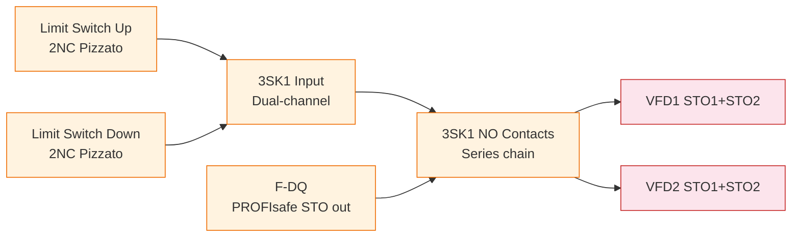

---
{
  "format": 1,
  "metadata": {
    "id": "system-block-diagram-tool-evaluation",
    "title": "System block-diagram tool evaluation and Mermaid-first recommendation",
    "question": "Which diagram format balances simple owner editing and recoverable architecture for a four-column car lift?",
    "scope": "Functional architecture, not terminal wiring; Mermaid/D2/draw.io/Graphviz in safety/power/network/I-O context.",
    "summary": "Recommends Mermaid-first with draw.io initial-editing fallback, retaining comparative tradeoffs and a proposed diagram plan.",
    "researched_at": "2026-07-21",
    "last_improved_at": null,
    "language": "en",
    "origin": {
      "kind": "imported",
      "platform": "unknown",
      "author": "unknown",
      "model": "unknown"
    },
    "related_reports": [],
    "warnings": [
      "Imported without fresh source or technical verification; historical findings are not current compliance, safety or legal certification.",
      "Original report bytes/citations are preserved. Third-party quotations, code and sources retain their own rights; unresolved local/transcript references remain unavailable.",
      "Inventory and safety-chain context not validated engineering evidence.",
      "Thin external citation context; tool capabilities not verified.",
      "Different constraints from fixed-coordinate HTML survey; no supersession inferred.",
      "Uninspected io_allocation.csv, bom.csv, car_lift.qet sheets 01-04.",
      "Proposed electronics/diagrams paths and future diagram artifacts.",
      "Component inventory, machine architecture and topology."
    ],
    "superseded_by": null,
    "created_at": "2026-11-01T23:31:46.474Z",
    "updated_at": "2026-11-01T23:31:46.474Z",
    "imported_at": "2026-11-01T20:38:59.891Z"
  },
  "warnings": [
    {
      "code": "unknown_origin",
      "message": "Original platform or author unknown; review attribution."
    },
    {
      "code": "unverified_import",
      "message": "Imported claims and publication rights have not been checked."
    }
  ],
  "sourceDigest": "8925b971c8eeb2ba23665dab4863888c2f30fc7d7602c5180db2e2153b108e12",
  "proposalRevision": "4d6e65bf7cf161389cc37d9df9a198846e1cf08b4c44a863731bc6db421bed4d"
}
---
# System Block Diagram — Tool Evaluation & Recommendation

**Date:** 2026-07-21
**Context:** Need a functional block diagram of the 4-column car lift system showing
components and their interconnections at the architecture/logic level (not wiring
detail). Primary use: safety chain evaluation for risk assessment (ISO 13849).

**Constraint:** Tool must be simple for the user AND let Claude recover structured
information from the diagram later.

---

## 1. What we need to diagram

The car lift has ~25 distinct component *types* organized into 4 functional domains:

```
Machine Room (cabinet)        Safety Chain               Moving Platform
─────────────────────────     ────────────────           ──────────────────
Main disconnect 63A          3SK1 safety relay          IM 155-6 PN ST (bus coupler)
Phase monitor 3UG4617        Limit switches (up+down)   4× SIWAREX WP351
2× VFD Frenic-Lift           F-TM Count (4 encoders)    4× Load cells (6-wire)
2× Braking resistors         F-DI (2× door switches)    DI 8×24V (5 buttons+key)
4× 3RT2 reversing contactors F-DQ (STO output)          DQ 8×24V (3 lights+GSM)
2× ROBA-SBCplus brake ctrl   IO-Link Safety master      
4× ROBA-stop-M brakes        3× Pizzato stations        
SITOP 24V PSU + UPS          Energy chain (2 cables)    
2× 230V UPS                                            
SCALANCE XC208 switch                                   
CPU 1214FC + SM1223                                     
KTP700 Basic HMI                                        

Standard I/O                PROFINET network
Floor key+buttons → IO-Link
```

Connections fall into 4 categories:
1. **Safety chain** (series — any break kills STO)
2. **Power flow** (400V → VFDs → motors; 24V DC distribution; 230V UPS)
3. **PROFINET** (8-node star topology)
4. **Standard I/O** (PLC ↔ platform controls, brakes, contactors, GSM, WP351)

---

## 2. Tools evaluated

### A. Mermaid — diagram-as-text, GitHub-native

**Format:** Plain text in fenced code blocks (` ```mermaid `). Renders natively on GitHub, GitLab, Notion.

**For the user:**
- Write/edit in any text editor
- GitHub renders automatically — no tool install needed
- Syntax is simple: `A[Component] --> B[Component]` for connections
- Color classes map to functional domains (safety = orange, power = red, network = blue)

**For Claude:**
- Reads the raw text directly — zero parsing overhead
- Can generate/modify Mermaid from conversation context
- Can validate node/edge consistency against `io_allocation.csv`

**Example (safety chain excerpt):**


**Verdict:** ⭐ Best overall. Both human and machine writable/readable. No render step.

---

### B. D2 — modern diagram-as-code, best auto-layout

**Format:** Plain text (`.d2` files). Renders to SVG/PNG via single Go binary.

**For the user:** Clean syntax, hot-reload (`d2 --watch`), professional themes out of the box. Needs `d2` binary installed (`curl -fsSL https://d2lang.com/install.sh | sh`).

**For Claude:** Read/write text easily. Can generate complex architecture diagrams with less layout fighting than Mermaid.

**Key limitation:** No GitHub native rendering — must commit generated SVGs alongside source. Two files to keep in sync.

**Verdict:** Better visual output than Mermaid for complex diagrams (>15 nodes). Extra render step is the main drawback.

---

### C. draw.io — GUI, XML-embedded format

**Format:** XML (`.drawio`), with optional PNG+XML embedding for round-tripping.

**For the user:** Full GUI drag-and-drop. Easiest to start with. PNG-with-embedded-XML means a single file is both the picture AND the editable source.

**For Claude:** Parseable via standard XML parser. Structure: `<mxGraphModel> → <mxCell vertex="1">` (nodes), `<mxCell edge="1" source="X" target="Y">` (edges). Labels in `value` attribute. Can extract nodes/edges/connections programmatically.

**Example Python parser (5 lines):**
```python
import xml.etree.ElementTree as ET
tree = ET.parse("diagram.drawio")
root = tree.getroot()
vertices = [c for c in root.iter('mxCell') if c.get('vertex') == '1']
edges = [c for c in root.iter('mxCell') if c.get('edge') == '1']
```

**Key limitation:** Claude can READ draw.io XML but can't easily WRITE it (hundreds of XML elements with pixel coordinates). The user creates manually, Claude consumes.

**Verdict:** Best for user-initial-creation. Claude can parse and validate against known architecture. Not good for bidirectional editing.

---

### D. Graphviz/DOT — best layout engine

**Format:** DOT language (plain text). Renders via `dot` binary.

**For the user:** Text-based, powerful automatic layout. Steep learning curve for styling. No GitHub native rendering.

**For Claude:** Excellent — DOT is easily generated and parsed. Best auto-layout of any tool.

**Verdict:** Overkill for this use case. Mermaid or D2 provide 90% of the value with less friction.

---

## 3. Comparison matrix

| Criterion | Mermaid | D2 | draw.io | Graphviz |
|-----------|---------|-----|---------|----------|
| **User writes** | ✅ Text, easy | ✅ Text, clean | ✅ GUI, easy | ⚠️ DOT, steep |
| **User edits** | ✅ Any editor | ✅ Any editor | ✅ GUI | ✅ Any editor |
| **Claude reads** | ✅ Raw text | ✅ Raw text | ✅ XML parse | ✅ Raw text |
| **Claude writes/modifies** | ✅ Easy | ✅ Easy | ❌ Hard | ✅ Easy |
| **GitHub renders natively** | ✅ Yes | ❌ Need SVG | ✅ As PNG | ❌ Need SVG |
| **Layout quality** | ⚠️ OK <15 nodes | ✅ Excellent | ✅ Manual | ✅ Excellent |
| **Color/domain coding** | ✅ cssClass | ✅ Themes | ✅ GUI | ⚠️ Manual |
| **Install required** | ❌ None | ✅ `d2` binary | ❌ Web app | ✅ `graphviz` |
| **Safety palette ready** | ✅ Classes | ✅ Themes | ✅ Shapes | ⚠️ DIY |
| **CI/CD pipeline** | ✅ Trivial | ✅ Single binary | ❌ N/A | ✅ Single binary |

---

## 4. Recommended approach: Mermaid-first + draw.io option

### Primary format: **Mermaid** (`.mmd` or `.md` files)

Store as `electronics/diagrams/system_architecture.md` — a Markdown file with embedded Mermaid diagrams, rendered natively by GitHub.

**Why Mermaid wins for this project:**
1. **Zero tooling** — works today on any machine with a browser
2. **Bidirectional** — both user and Claude can read and write the same file
3. **GitHub-native** — self-documenting repo; the diagram IS the documentation
4. **Incremental** — start simple, add detail over time
5. **Safety color coding** — `classDef` maps perfectly to functional zones

### Optional fallback: **draw.io** for initial creation

If the user prefers visual editing, create the diagram in draw.io once, then:
1. Save as `.drawio` (XML source)
2. Claude parses the XML to extract nodes/edges
3. Claude generates the equivalent Mermaid for long-term maintenance
4. Both files committed: `.drawio` (editable source) + `.md` (rendered, Claude-readable)

### What NOT to use: SISTEMA

The ISO 13849 SISTEMA tool is for calculating PFH/PL from component reliability data (MTTFd, B10d, DC). It's a calculation engine, not a block diagramming tool. The block diagram we create here would be *input* to a SISTEMA analysis later, but SISTEMA itself is Windows-only and requires detailed component reliability parameters we don't have yet.

---

## 5. Proposed file structure

```
electronics/diagrams/
├── system_architecture.md       # Mermaid: full system block diagram
│   ├── §1 Power Distribution    # 400V bus → VFDs → motors + 24V DC + UPS
│   ├── §2 Safety Chain          # Sensor → Logic → Actuator (ISO 13849 SRP/CS)
│   ├── §3 Control & I/O         # PLC ↔ platform, brakes, contactors
│   ├── §4 PROFINET Network      # 8-node star topology
│   └── §5 Legend                # Color code, line style conventions
├── safety_chain_srpcs.md        # Mermaid: SRP/CS breakdown per safety function
│   ├── SF1 — Overtravel (Cat 3, 3SK1 hardwired)
│   ├── SF2 — Overspeed (Cat 3, F-TM Count + PROFIsafe)
│   ├── SF3 — Door interlock (Cat 3, F-DI + PROFIsafe)
│   ├── SF4 — E-Stop (Cat 3, IO-Link Safety)
│   └── SF5 — STO actuation (combined output)
└── README.md                    # Diagram conventions, update procedures
```

---

## 6. Concrete proposal

I recommend we proceed as follows:

1. **I generate an initial Mermaid system architecture diagram** based on `io_allocation.csv`, `car_lift.qet` sheets 01–04, and `bom.csv`
2. **You review the diagram** — does it match your mental model? Are components grouped correctly? Are the safety chain connections right?
3. **We iterate** — Mermaid is text, so changes are quick
4. **Add to the repo** as `electronics/diagrams/system_architecture.md`

The initial diagram would have ~6 sub-diagrams:
- **Power** (400V → VFDs → motors, 24V PSU+UPS distribution, 230V UPS emergency path)
- **Safety chain** (functional SRP/CS: limit switches → 3SK1; encoders → F-TM Count; doors → F-DI; E-stops → IO-Link; all → F-DQ + 3SK1 NO → VFD STO)
- **Control** (PLC ↔ contactors, brakes, VFDs, stack light, GSM, HMI)
- **Platform** (ET 200SP modules → load cells, buttons, lights, GSM via M12 connectors through energy chain)
- **PROFINET** (SCALANCE star topology, all 8 devices with IPs)
- **Safety chain truth table** (per-function: trip source → detection → actuation)

Would you like me to go ahead and draft the Mermaid architecture diagram? Or do you have a preference for one of the alternative approaches (draw.io first, D2, etc.)?
